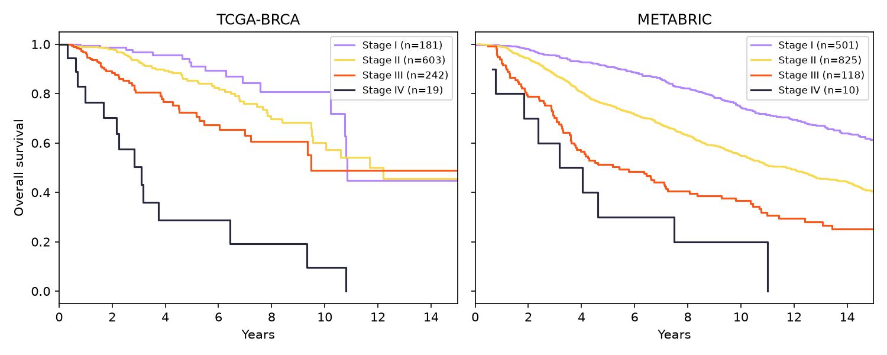
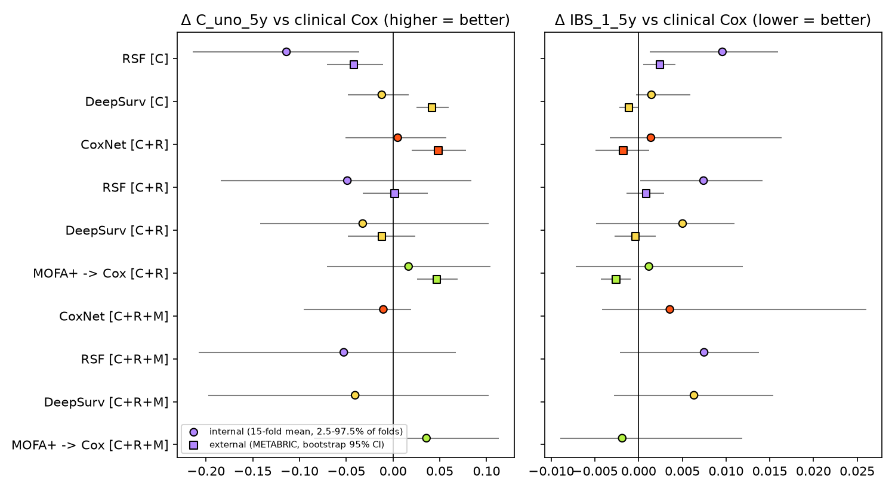
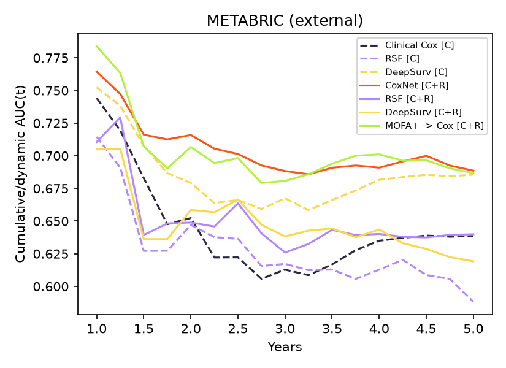
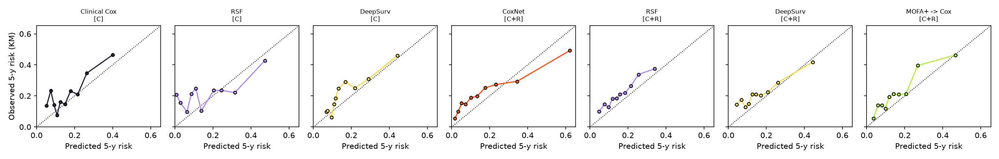

# Do omics predict breast-cancer survival better than clinical stage? (TCGA-BRCA → METABRIC)

A small, reproducible study on public data. It is **not novel research** and **not clinical-grade**. It asks one question with standard models and an external cohort, and reports the answer whichever way it goes.

## Question
In breast cancer, does adding tumour RNA-seq (and DNA methylation) to a Cox model with **age + AJCC stage** improve the prediction of overall survival, and does any gain hold up in an independent cohort?

## Short answer
Better than age + stage alone, yes, externally. Better than a plain Cox model that also has ER/PR/HER2 and node status, no (see the follow-up). The main analysis first attributed the gain to a flexible clinical model, but the follow-up did not confirm that.
- **Internal (TCGA, 15 CV folds):** no omic model beats the age + stage Cox reliably. Fold-to-fold spread is larger than every mean difference. Adding methylation to RNA does not help.
- **External (METABRIC):** CoxNet and MOFA+ on RNA beat the clinical Cox by about +0.05 Uno C-index (bootstrap CIs exclude 0). But **DeepSurv on age + stage alone gains +0.042**. Against that clinical-only model the RNA gain shrinks to +0.005 to +0.007, with CIs from about -0.02 to +0.03.
- So most of the apparent external benefit of omics over the linear Cox comes from using the same two clinical variables more flexibly, not from the transcriptome.
- **Follow-up (external only, [below](#follow-up-dss-endpoint-and-a-richer-clinical-baseline)):** the DeepSurv-C explanation is fragile, because its advantage disappears on disease-specific survival and with more clinical variables. The sturdier result is different: once a *linear* Cox also gets ER, PR, HER2, node status and a quadratic age term, RNA adds nothing on either endpoint (ΔC -0.010 to -0.001, CIs about ±0.02). Against age + stage only, RNA does help for disease-specific survival (MOFA+ +0.067). So what RNA adds over stage looks like information that receptor and node status already carry.

## Data
| Cohort | Source | Use |
|---|---|---|
| TCGA-BRCA | UCSC Xena TCGA hub: `HiSeqV2` (log2 RSEM+1), `HumanMethylation450` (beta). Survival, age and stage from the TCGA Clinical Data Resource (Liu et al. 2018, *Cell*), Xena PanCan hub | training + internal validation |
| METABRIC | cBioPortal datahub `brca_metabric`: Illumina HT-12 microarray, patient and sample clinical files | external validation only |

Files are downloaded by `src/data.py` and md5s recorded in `results/data_files.csv`. `data/` is git-ignored (~1.5 GB).

### Cohorts (`results/data_summary.csv`)
| Cohort | n | Deaths | Deaths ≤ 5 y | Median follow-up of censored (y) | Stage I / II / III / IV |
|---|---|---|---|---|---|
| TCGA, RNA (external training set) | 1045 | 139 | 94 | 2.1 | 181 / 603 / 242 / 19 |
| TCGA, RNA + methylation (internal CV cohort) | 759 | 94 | 68 | 2.1 | 125 / 429 / 195 / 10 |
| METABRIC (external test set) | 1454 | 821 | 307 | 13.7 | 501 / 825 / 118 / 10 |

- TCGA: women, primary tumour samples (`-01`), AJCC pathologic stage I-IV (substages collapsed; Stage X / discrepancy / missing dropped), OS > 0.
- METABRIC: stage 1-4 from `data_clinical_sample.txt`. Stage 0 and missing stage are dropped, which removes 526 of the 1980 patients with expression data (27%).
- In METABRIC, 333 of the 821 deaths are recorded as "died of other causes". OS is a noisy endpoint for a tumour-expression model; see Limitations.
- Age + stage behave as expected and similarly in both cohorts (`results/clinical_cox_hr.csv`). The hazard ratio per 10 years of age is 1.44 in TCGA and 1.39 in METABRIC; vs stage I, stage II is 1.83 / 1.67, stage III 3.73 / 2.96 and stage IV 11.3 / 4.8.



## Methods
**Endpoint:** overall survival, 5-year horizon (TCGA follow-up is short: median 2.1 y among censored patients).

**Feature sets:** **C** = age (per decade, centred at 60) + stage II/III/IV dummies, a fixed transform. **C+R** = C + 2000 genes. **C+R+M** = C+R + 5000 CpGs (internal only; METABRIC has no 450k data).

**Omics preprocessing (outcome-free, once per cohort).** Genes present in both cohorts are kept. Among genes with above-median variance in METABRIC (to avoid the microarray noise floor), the top 2000 by TCGA variance are selected. CpGs need < 20% missing values; the top 5000 by variance are median-imputed. **Every block is z-scored within its own cohort**, the only correction for the RNA-seq vs microarray shift. These filters use all TCGA tumours, not only the training fold. They never see outcomes, but this is a deviation from strict in-fold preprocessing. PCA and MOFA+ are fitted inside each training fold.

**Models** (`src/models.py`):
| Model | Inputs | Details |
|---|---|---|
| Clinical Cox (reference) | C | `sksurv` `CoxPHSurvivalAnalysis` |
| CoxNet | C + omics | elastic net (l1_ratio 0.5), clinical terms unpenalised, alpha by 3-fold inner CV (Harrell C) on a 30-value path (`alpha_min_ratio` 0.1) |
| Random Survival Forest | C + 32 PCs per omic block | 300 trees, `min_samples_leaf` ∈ {10, 30} by OOB C-index |
| DeepSurv | C + 32 PCs per omic block | one hidden layer (32, ReLU, dropout 0.3), Cox partial-likelihood loss, Adam, early stopping on a 20% inner split; Breslow baseline |
| MOFA+ → Cox | C + 15 MOFA+ factors | `mofapy2` on the omic views of the training fold; factors for any patient = least-squares projection on the stacked weights (same rule for train, test and METABRIC); ridge Cox |

RSF and DeepSurv also run on **C alone**. This separates "a more flexible model" from "omics information".

**Validation.**
- *Internal:* 3 × 5-fold stratified CV on the 759 TCGA patients with RNA + methylation (seed 0). Every feature set is evaluated on the same patients and folds, so differences are paired by fold. I report the mean and the 2.5-97.5% range of the 15 per-fold differences. These are not confidence intervals, because folds overlap.
- *External:* each model (C and C+R only) is fitted once on all 1045 TCGA patients with RNA and applied unchanged to METABRIC. There is no recalibration or refitting. Paired 95% CIs come from 1000 bootstrap resamples of METABRIC patients; the same resamples are used for every model.
- *Metrics* (`scikit-survival`): Uno's C-index truncated at 5 y, Harrell's C, cumulative/dynamic AUC at 3 and 5 y, Integrated Brier Score over 1-5 y. The IPCW censoring distribution is estimated on the whole evaluation cohort. All rank metrics use the predicted 5-y risk (3-y risk for AUC(3 y)).
- *Calibration (METABRIC):* predicted vs Kaplan-Meier 5-y risk in deciles; calibration slope (Cox coefficient of the cloglog-transformed predicted 5-y risk; 1 = ideal); O/E = observed KM 5-y risk / mean predicted 5-y risk.
- *Sanity check:* the internal CV is repeated (1 repeat) with omic rows permuted across patients, keeping the outcomes.

## Results

### Internal: TCGA-BRCA, 3 × 5-fold CV (mean ± SD over 15 folds; `results/cv_summary.csv`)
| Model | Features | Uno C (5 y) | AUC(5 y) | IBS (1-5 y) |
|---|---|---|---|---|
| Clinical Cox | C | 0.706 ± 0.068 | 0.710 ± 0.079 | 0.0721 ± 0.0072 |
| RSF | C | 0.592 ± 0.078 | 0.588 ± 0.084 | 0.0816 ± 0.0080 |
| DeepSurv | C | 0.694 ± 0.065 | 0.696 ± 0.083 | 0.0735 ± 0.0083 |
| CoxNet | C+R | 0.711 ± 0.063 | 0.716 ± 0.084 | 0.0735 ± 0.0093 |
| RSF | C+R | 0.657 ± 0.054 | 0.661 ± 0.060 | 0.0795 ± 0.0067 |
| DeepSurv | C+R | 0.673 ± 0.067 | 0.670 ± 0.083 | 0.0771 ± 0.0075 |
| MOFA+ factors -> Cox | C+R | 0.722 ± 0.054 | 0.731 ± 0.069 | 0.0732 ± 0.0089 |
| CoxNet | C+R+M | 0.695 ± 0.053 | 0.703 ± 0.069 | 0.0756 ± 0.0100 |
| RSF | C+R+M | 0.653 ± 0.060 | 0.657 ± 0.075 | 0.0795 ± 0.0069 |
| DeepSurv | C+R+M | 0.665 ± 0.068 | 0.670 ± 0.083 | 0.0784 ± 0.0084 |
| MOFA+ factors -> Cox | C+R+M | 0.742 ± 0.038 | 0.751 ± 0.057 | 0.0702 ± 0.0089 |

### External: METABRIC (`results/external_metrics.csv`)
| Model | Features | Uno C (5 y) | AUC(3 y) | AUC(5 y) | IBS (1-5 y) | Calibration slope | O/E (5 y) |
|---|---|---|---|---|---|---|---|
| Clinical Cox | C | 0.623 | 0.613 | 0.639 | 0.0949 | 0.83 | 1.29 |
| RSF | C | 0.581 | 0.617 | 0.588 | 0.0973 | 0.24 | 1.29 |
| DeepSurv | C | 0.664 | 0.667 | 0.685 | 0.0938 | 0.90 | 1.25 |
| CoxNet | C+R | 0.671 | 0.688 | 0.689 | 0.0931 | 0.43 | 1.20 |
| RSF | C+R | 0.625 | 0.626 | 0.640 | 0.0958 | 0.57 | 1.31 |
| DeepSurv | C+R | 0.611 | 0.638 | 0.619 | 0.0946 | 0.42 | 1.29 |
| MOFA+ factors -> Cox | C+R | 0.670 | 0.681 | 0.687 | 0.0923 | 0.68 | 1.31 |

### Paired differences vs the clinical Cox (`results/paired_deltas.csv`, `ref = cox|C`)
Internal: fold mean [2.5-97.5% of folds]. External: point estimate [bootstrap 95% CI]. Positive ΔC and negative ΔIBS favour the model.

| Model | Features | Internal ΔC | External ΔC | Internal ΔIBS | External ΔIBS |
|---|---|---|---|---|---|
| RSF | C | -0.114 [-0.214, -0.036] | -0.042 [-0.071, -0.011] | +0.0096 [+0.0012, +0.0160] | +0.0024 [+0.0005, +0.0042] |
| DeepSurv | C | -0.012 [-0.048, +0.017] | **+0.042 [+0.025, +0.060]** | +0.0015 [-0.0003, +0.0059] | -0.0011 [-0.0022, -0.0001] |
| CoxNet | C+R | +0.005 [-0.051, +0.057] | **+0.049 [+0.020, +0.078]** | +0.0014 [-0.0033, +0.0164] | -0.0018 [-0.0049, +0.0012] |
| RSF | C+R | -0.049 [-0.184, +0.084] | +0.002 [-0.032, +0.037] | +0.0074 [+0.0002, +0.0142] | +0.0009 [-0.0014, +0.0029] |
| DeepSurv | C+R | -0.032 [-0.142, +0.102] | -0.012 [-0.048, +0.024] | +0.0050 [-0.0049, +0.0110] | -0.0004 [-0.0027, +0.0020] |
| MOFA+ factors -> Cox | C+R | +0.017 [-0.071, +0.104] | **+0.047 [+0.026, +0.069]** | +0.0012 [-0.0072, +0.0119] | -0.0026 [-0.0044, -0.0009] |
| CoxNet | C+R+M | -0.010 [-0.095, +0.019] | — | +0.0036 [-0.0042, +0.0260] | — |
| RSF | C+R+M | -0.053 [-0.208, +0.067] | — | +0.0075 [-0.0021, +0.0137] | — |
| DeepSurv | C+R+M | -0.041 [-0.198, +0.102] | — | +0.0063 [-0.0029, +0.0154] | — |
| MOFA+ factors -> Cox | C+R+M | +0.036 [-0.085, +0.113] | — | -0.0019 [-0.0090, +0.0118] | — |



### Paired differences vs the flexible clinical model (`ref = deepsurv|C`)
This contrast was added after seeing the table above. DeepSurv-C uses only age + stage, so it measures what the omics add over the best clinical-only model in this study.

| Model | Features | Internal ΔC | External ΔC | Internal ΔIBS | External ΔIBS |
|---|---|---|---|---|---|
| Clinical Cox | C | +0.012 [-0.017, +0.048] | -0.042 [-0.060, -0.025] | -0.0015 [-0.0059, +0.0003] | +0.0011 [+0.0001, +0.0022] |
| CoxNet | C+R | +0.017 [-0.044, +0.084] | +0.007 [-0.022, +0.033] | -0.0001 [-0.0048, +0.0148] | -0.0007 [-0.0040, +0.0025] |
| MOFA+ factors -> Cox | C+R | +0.029 [-0.071, +0.119] | +0.005 [-0.020, +0.030] | -0.0003 [-0.0095, +0.0076] | -0.0015 [-0.0034, +0.0004] |
| DeepSurv | C+R | -0.020 [-0.123, +0.102] | -0.054 [-0.091, -0.017] | +0.0036 [-0.0072, +0.0105] | +0.0007 [-0.0018, +0.0031] |
| RSF | C+R | -0.037 [-0.176, +0.079] | -0.040 [-0.072, -0.009] | +0.0060 [-0.0009, +0.0140] | +0.0020 [-0.0001, +0.0039] |

The time-dependent AUC curve shows the same picture. CoxNet and MOFA+ with RNA sit above DeepSurv-C mainly in the first 1-3 years (ΔAUC(3 y) vs DeepSurv-C: CoxNet +0.021 [-0.019, +0.061], MOFA+ +0.013 [-0.024, +0.051]). By 5 years the curves meet.



### Calibration in METABRIC
Every model under-predicts 5-year risk in METABRIC (O/E 1.20-1.31). The baseline hazard comes from TCGA, and METABRIC is older, followed longer and has many non-cancer deaths. The clinical Cox (slope 0.83) and DeepSurv-C (0.90) rank-separate risk at roughly the right spread. The omic models are too extreme (slopes 0.42-0.68): their high-risk predictions overshoot, the usual sign of overfitting that discrimination metrics hide.



### Sanity check: permuted omics (`results/sanity.csv`, 5 folds)
With omic rows shuffled across patients, CoxNet C+R falls back to the clinical model (ΔC +0.007 ± 0.012, because it shrinks the noise away). MOFA+ C+R gives -0.012 ± 0.064. DeepSurv and RSF on C+R lose more with permuted omics (-0.099 and -0.081) than with the real ones (-0.032 and -0.049). So the real expression data carry some signal for those models; it just does not translate into a gain over the clinical baseline.

## Interpretation
- Internally, TCGA has too few events (68 deaths within 5 years in the CV cohort) to resolve differences of a few hundredths of C-index. Every interval spans zero.
- Externally, there is enough power, and the RNA models do beat the linear age + stage Cox. A neural network given only age + stage closes most of that gap, though, and the remaining RNA gain (+0.005 to +0.007 C) is not distinguishable from zero. I did not investigate which non-linearity DeepSurv-C exploits (a non-linear age effect on OS is the obvious candidate).
- Methylation never helped. CoxNet with methylation was slightly worse than with RNA alone; MOFA+ with both views had the best internal mean but also a wide spread, and it cannot be tested externally.
- The non-linear models on PCs (RSF, DeepSurv C+R) were the weakest omic models, in line with the usual finding that penalised Cox models are hard to beat for omics survival.

## Follow-up: DSS endpoint and a richer clinical baseline
Run after the main analysis, on the two weaknesses listed below (`scripts/followup.py` → `results/followup_*.csv`, about 7 minutes). External validation only: TCGA has 67 disease-specific deaths in this cohort, too few for internal CV.
- **Endpoints:** OS, and DSS, which counts deaths from breast cancer only. TCGA-CDR `DSS`; in METABRIC `VITAL_STATUS == "Died of Disease"`, with deaths from other causes censored.
- **Baselines:** age + stage, or *rich* = age + stage + (age - 60)²/100 + ER+ + PR+ + HER2+ + any positive node. The HER2 rule in TCGA is the nature2012 final status, else FISH, else IHC, with equivocal counted as missing. Grade is not available in TCGA, so it is not used.
- **Same patients in all four cells:** complete cases for every covariate and both endpoints. TCGA has 940 patients (105 OS deaths, 67 DSS deaths); METABRIC has 1398 (790 OS deaths, 469 DSS deaths). Models: clinical Cox, DeepSurv [C], CoxNet [C+R], MOFA+ [C+R], with the same code as the main analysis. 1000 paired bootstraps.

METABRIC Uno C (5 y), with calibration slope in brackets (`results/followup_metrics.csv`):

| Model | OS, age+stage | OS, rich | DSS, age+stage | DSS, rich |
|---|---|---|---|---|
| Clinical Cox | 0.613 (0.85) | **0.693** (0.79) | 0.641 (0.80) | **0.725** (0.63) |
| DeepSurv [C] | 0.657 (0.94) | 0.627 (0.63) | 0.577 (0.70) | 0.657 (0.66) |
| CoxNet [C+R] | 0.644 (0.43) | 0.692 (0.59) | did not converge | did not converge |
| MOFA+ [C+R] | 0.651 (0.62) | 0.691 (0.60) | 0.708 (0.53) | 0.715 (0.41) |

ΔUno C vs the clinical Cox *with the same baseline*, bootstrap 95% CI (`results/followup_deltas.csv`, `ref = cox|C`):

| Model | OS, age+stage | OS, rich | DSS, age+stage | DSS, rich |
|---|---|---|---|---|
| DeepSurv [C] | +0.045 [+0.024, +0.067] | -0.066 [-0.090, -0.042] | -0.063 [-0.119, -0.008] | -0.068 [-0.098, -0.037] |
| CoxNet [C+R] | +0.032 [-0.001, +0.061] | -0.001 [-0.022, +0.019] | – | – |
| MOFA+ [C+R] | +0.038 [+0.017, +0.060] | -0.002 [-0.022, +0.017] | +0.067 [+0.027, +0.106] | -0.010 [-0.032, +0.012] |

What this shows:
- **The OS, age + stage cell reproduces the main analysis** on this smaller complete-case cohort (DeepSurv-C +0.045, MOFA+ +0.038).
- **DeepSurv-C is not a robust reference.** It loses to the linear Cox on DSS and with the rich baseline. Its OS gain in the main analysis is probably specific to OS, where age (and so non-cancer death) matters most, and its early stopping on a small validation split is noisy. The main-analysis claim "the gain is explained by a flexible clinical model" should therefore be read as weak.
- **A richer linear clinical model removes the RNA gain on both endpoints.** On OS it beats every age + stage model, and both RNA models are within ±0.02 of it. On DSS, where RNA helps against age + stage alone (+0.067), adding receptor and node status takes that gain to -0.010 [-0.032, +0.012].
- **CoxNet did not converge on DSS.** sksurv's coordinate descent diverges with the stage IV dummy unpenalised: in TCGA, 11 of 14 stage IV patients die of the cancer. A tiny clinical penalty only converges with absurd clinical coefficients, so CoxNet-DSS is reported as missing, not patched.
- Calibration repeats the main pattern: omic models are more over-dispersed than the clinical Cox. All models under-predict risk in METABRIC, more for DSS (O/E 1.6-2.3) than OS (1.4-1.5).
- This follow-up was listed as future work in the first write-up, but it was designed after the main results were seen.

## Limitations
- **Endpoint:** OS mixes cancer and non-cancer deaths (41% of METABRIC deaths are "other causes"). DSS is covered only by the external follow-up above.
- **Clinical baseline is minimal on purpose** (age + stage, as asked). The follow-up above adds ER/PR/HER2, nodes and quadratic age externally; grade was not available in TCGA.
- **Platform shift:** RNA-seq (TCGA) vs Illumina microarray (METABRIC), handled only by per-cohort z-scoring of each gene. The METABRIC z-scores use all METABRIC samples (outcome-free, but transductive).
- **Outcome-free filters on the whole TCGA cohort** (gene/CpG variance) rather than per fold.
- **Methylation is internal only**, and the internal cohort is small.
- **Little tuning:** RSF (2 leaf sizes), DeepSurv (no architecture search, trained on 80% of the data) and MOFA+ (15 factors fixed) were not tuned beyond what is listed. RSF on 4 clinical columns does poorly, probably because `max_features="sqrt"` lets each split see only 2 variables; not investigated.
- **One change after the first full run:** CoxNet's alpha path was cut at `alpha_min_ratio=0.1`. In one fold the inner CV had picked a near-unpenalised fit (514 omic features, ~75 events) whose Breslow baseline degenerated (predicted survival > 1). The pipeline now fails loudly on invalid survival curves.
- **The DeepSurv-C reference was added after seeing the results** (see above). It is a post-hoc comparison and should be read as such.
- METABRIC loses 27% of patients for missing stage; stage IV has only 10 patients in METABRIC and 10 in the internal cohort.

## Reproduce
```bash
CONDA_PKGS_DIRS="$HOME/.conda/pkgs" mamba create -p "$HOME/.conda/envs/multiomics-surv" python=3.12 pip
"$HOME/.conda/envs/multiomics-surv/python.exe" -m pip install -r requirements.txt
"$HOME/.conda/envs/multiomics-surv/python.exe" -W ignore scripts/run.py
"$HOME/.conda/envs/multiomics-surv/python.exe" -W ignore scripts/followup.py
```
About 40 minutes on a 16-core Windows machine (CPU only) with `N_JOBS = 6` (MOFA+ dominates; 16 GB RAM does not fit more parallel MOFA fits). The first run also downloads ~1.5 GB and builds the omics caches (~3 min). Two consecutive full runs gave identical CSVs, apart from differences of about 1e-17 in RSF metrics from multithreaded summation. Changing `N_JOBS` changes BLAS threading and can move results slightly. `--quick` (1 repeat, 50 bootstraps) is for development only.

## Files
- `notebook.ipynb`: guided walkthrough that reads `results/` (opens in seconds, renders on GitHub).
- `src/data.py`: downloads, cohorts, harmonisation; `src/models.py`: the five model families; `src/evaluate.py`: metrics, bootstrap, calibration, figures; `scripts/run.py`: main analysis; `scripts/followup.py`: DSS / rich-baseline follow-up.
- `results/`: `data_summary.csv`, `data_files.csv`, `clinical_cox_hr.csv`, `cv_metrics.csv` (per fold), `cv_summary.csv`, `external_metrics.csv`, `paired_deltas.csv`, `calibration.csv`, `hparams.csv`, `sanity.csv`, `run.log`, `figures/`; follow-up: `followup_cohorts.csv`, `followup_metrics.csv`, `followup_deltas.csv`, `followup.log`.

## References
- Liu J. et al. (2018). An integrated TCGA pan-cancer clinical data resource to drive high-quality survival outcome analytics. *Cell* 173:400-416.
- Curtis C. et al. (2012). The genomic and transcriptomic architecture of 2,000 breast tumours reveals novel subgroups. *Nature* 486:346-352 (METABRIC).
- Argelaguet R. et al. (2020). MOFA+: a statistical framework for comprehensive integration of multi-modal single-cell data. *Genome Biology* 21:111.
- Katzman J. et al. (2018). DeepSurv: personalized treatment recommender system using a Cox proportional hazards deep neural network. *BMC Med Res Methodol* 18:24.
- Ishwaran H. et al. (2008). Random survival forests. *Ann Appl Stat* 2:841-860.
- Simon N. et al. (2011). Regularization paths for Cox's proportional hazards model via coordinate descent. *J Stat Softw* 39(5).
- Pölsterl S. (2020). scikit-survival. *JMLR* 21(212):1-6.
